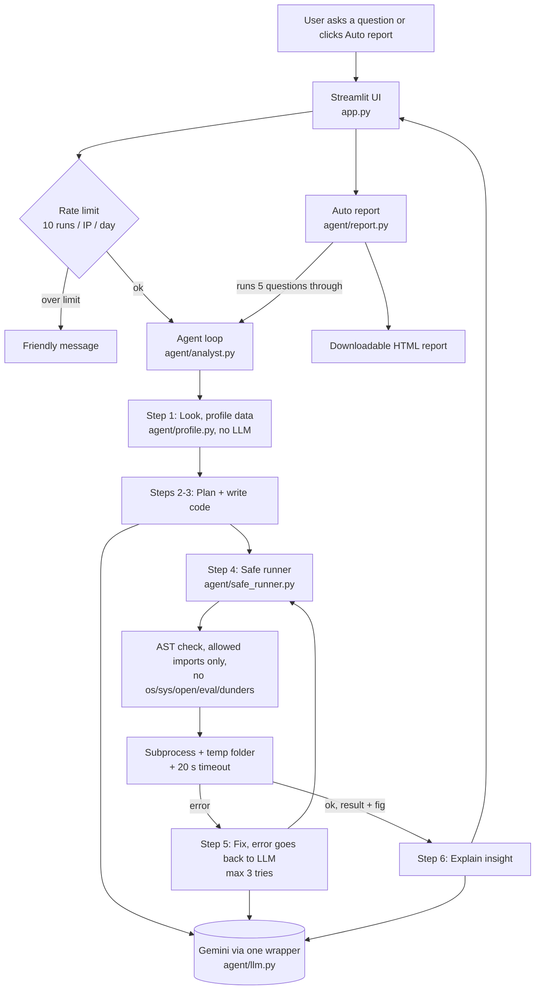

# AskYourData

**An AI data analyst agent: upload a spreadsheet, ask a question in plain English, and the agent plans, writes Python, runs it, fixes its own errors, and answers with a chart and a short insight.**

**Live demo:** _coming soon (link added after deployment)_ · no sign-up needed, click **"Try with sample data"**

> **Demo GIF / screenshot:** _coming soon_
<!-- TODO: add docs/demo.gif (a question + the "How the agent did it" panel) and replace the line above with:
 -->

---

## The problem

Business teams sit on spreadsheets full of answers but wait days for an analyst to pull them out.
Generic chatbots guess at numbers instead of calculating them. AskYourData computes every number
with real code on your data, shows its working, and explains the result in plain business language.

## What the agent does

1. **Looks** at the data: columns, types, sample rows and basic stats (plain pandas, no AI).
2. **Plans** the analysis in a few short steps.
3. **Writes Python code** (pandas + plotly) that puts the answer in `result` and the chart in `fig`.
4. **Runs** the code in a safe runner: checked first, then run in a separate process with a 20-second timeout.
5. **Fixes its own errors:** if the code fails, the agent reads the error message, diagnoses it and rewrites the code. Up to **3 tries**, and every try is shown on screen.
6. **Explains** the result in 2–4 sentences, using only numbers the code actually produced.

**Auto report:** one click and the agent explores the data on its own. It proposes 6 questions, runs each through the loop above, keeps the 5 that work, writes an executive summary, and gives you a downloadable HTML report.

## Architecture



Every step is recorded as a `Step` object, so the UI can show the agent's plan, code, errors and fixes in the **"How the agent did it"** panel.

**Project layout**

```
app.py                 Streamlit UI (chat tab + auto report tab)
ui_render.py           Draws answers and the agent-steps panel
rate_limit.py          Per-visitor daily limit
cli.py                 Command-line version of the agent
agent/
  analyst.py           The agent loop (look -> plan -> code -> run -> fix -> explain)
  report.py            Auto report + HTML export
  safe_runner.py       AST check + subprocess runner
  _harness.py          Runs inside the subprocess
  llm.py               The only file that talks to Gemini (easy to swap provider)
  prompts.py           All prompt text
  profile.py           Data profiling (no LLM)
  samples.py           Sample datasets + example questions
data/
  make_sample_data.py  Generates the sample CSVs (fixed random seed)
tests/                 Offline tests with a fake LLM
```

## Tech stack

- **Python 3.12**, **Streamlit** (UI and hosting on Streamlit Community Cloud)
- **pandas**, **numpy**, **plotly** (analysis and interactive charts)
- **Google Gemini** free tier via the official `google-genai` SDK. The model is set by `LLM_MODEL` (default `gemini-3.5-flash-lite`), and `LLM_FALLBACK_MODEL` is used automatically if the main model is busy.
- **pytest** for offline tests (a scripted fake LLM, so no API key is needed)

## Run locally (Windows)

You need Python 3.12 and a free Gemini API key from <https://aistudio.google.com/apikey>.

```powershell
git clone https://github.com/Memoona-Amjad/askyourdata.git
cd askyourdata
py -3.12 -m venv .venv
.venv\Scripts\activate
pip install -r requirements.txt

copy .env.example .env
# open .env and paste your key after GEMINI_API_KEY=

streamlit run app.py
```

The app opens at <http://localhost:8501>.

Other useful commands:

```powershell
# Ask a question from the command line
python cli.py --sample sales "Which city brings in the most revenue?"

# Run the offline tests (no API key needed)
python -m pytest -q

# Re-create the sample datasets
python data\make_sample_data.py
```

## Limitations and next steps

- **The safe runner is a demo-level safety layer, not a full sandbox.** It blocks dangerous imports and
  built-ins with an AST check and runs code in a separate process with a timeout, but a determined attacker
  could still find a way around it. In production the code would run in a locked-down container sandbox
  (no network, read-only file system, CPU and memory limits), for example gVisor, Firecracker or a hosted code sandbox.
- **Free-tier AI quota.** Gemini's free tier has daily request limits per model. The app falls back to a second
  model when the first is busy, and limits each visitor to 10 runs a day, but a busy day can still run out.
- **The rate limit is kept in memory**, so it resets when the app restarts. Production would use Redis or a database.
- **The AI writes the wording, and code computes the numbers.** Insights are told to use only numbers from the
  result, but wording can still be imperfect. Check key figures before making decisions.
- **One table at a time.** No joins across multiple files or sheets yet (Excel reads the first sheet).
- **Large files:** uploads are capped at 20 MB, and very large tables make each run slower.
- **Next steps:** container sandbox; multi-file and multi-sheet support; follow-up questions that remember the
  previous answer; persistent rate limiting; caching repeated questions; a PDF report export.
